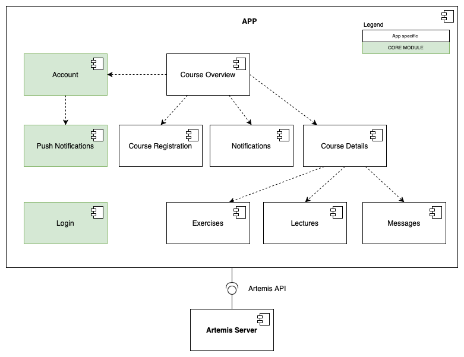

# Artemis iOS

The Artemis iOS application aims to replace the current Artemis web platform for iPhone users, providing a more user-friendly interface.
The application includes features such as course details, the respective lecture and exercise overview, exercise participation, and instant messaging. 

## Architecture

This section examines the subsystem decomposition of the `App`, as depicted in the referenced figure (`app-subsystem`).
The primary focus is identifying all `App` subsystems and their usage of the [Core Module](https://github.com/ls1intum/artemis-ios-core-modules/blob/main/README.md).
Subsystems part of the `Core Module` are highlighted in green, and arrows illustrate relationships between subsystems.
For the sake of simplicity, we do not show all `Core Module` subsystems.
Therefore the *User Session Store*, *Common Utility*, *Artemis Profile Info*, *API Client*, *Shared Models*, *Design Library*, *Shared Services*, and *Artemis Markdown* subsystems are not shown in the figure.
More information on the iOS core module (`ios-core-module`) can be found [here](https://github.com/ls1intum/artemis-ios-core-modules/blob/main/README.md).

The *Course Overview* subsystem serves as the app's home screen and thus encompasses all other subsystems.
Consequently, it has a dependency on the *Account*, *Course Registration*, *Notifications*, and *Course View* subsystems.

The *Course View* includes all details about a specific course and therefore uses the *Exercises*, *Lectures*, and *Messages* subsystems.
The *Exercises* subsystem is responsible for displaying all exercises as well as showing detailed information for a specific exercise.
It should also make exercise participation possible.
The *Lectures* subsystem lists all available lectures of the course, as well as all the respective lecture units and their attachments.
The *Messages* subsystem handles the interaction with the conversations and their messages.

The *Notification* subsystem displays the in-app notification center where the user can see past and current notifications with detailed information.

All subsystems where network communication is necessary use the *API Client*, although we do not depict this relationship in the diagram.

The *Login*, and *Account* subsystems manage the user authentication handling.
The *Push Notification* subsystem handles the registration, notification settings handling, decryption, and displaying of push notifications.

*Figure: Subsystem decomposition of the `App`.*

## Message composer

Messages, replies, edits, and forwarding comments share a native rich text composer. Bold,
italic, underline, strikethrough, inline code, links, flat bullet/numbered lists, block quotes, fenced code
blocks, and Artemis references are edited in place and stored using the existing Markdown
message format. Inline formatting is available in the native text-selection menu and the
single action row. **Aa** switches that row to horizontally scrolling formatting controls;
close and send stay reachable. **+** opens attachments and course references. Emoji, user
and channel actions are available in the default row. The grabber above the text expands
or collapses the editor by dragging or tapping, within the available keyboard/window height.

Typing `- ` or `1. ` starts a list; `> ` starts a quote. Return continues the list; Return on an empty item or
Backspace at its start returns to ordinary text. Code typing disables automatic correction,
capitalization, and smart punctuation. In a code block, Markdown stays literal;
Return on its final empty line exits the block. Backspace first selects a reference or link,
then removes it on the next press. The clipboard includes readable plain text and a private
Markdown representation so reference identifiers survive copying between Artemis composers.

Headings, nested quotes/lists, task lists, tables, unsupported HTML, and math remain read-only.
Their original content is preserved, and editing, sending, saving and resource actions are
blocked; existing edit sheets can be cancelled. For saved message or reply drafts, Discard
draft clears only that draft and restores composing. Pasting supported Markdown produces
formatted content, while unsupported pasted syntax is inserted as literal text. Drafts are
saved as editing occurs and restored when reopening a conversation or thread. Unchanged
older composers cannot overwrite newer edits or deletions when they disappear. File and
image attachment menus allow renaming their display names while keeping upload URLs intact,
including after restoring a draft. Sending preserves any newer text entered
while the request is in flight and clears the saved draft only after acceptance.

Reference pills use the appearance and text size from when their content is loaded. Changing
appearance or Dynamic Type while the same draft remains open does not currently redraw
existing pills. Native editor text still follows system accessibility and appearance settings.
